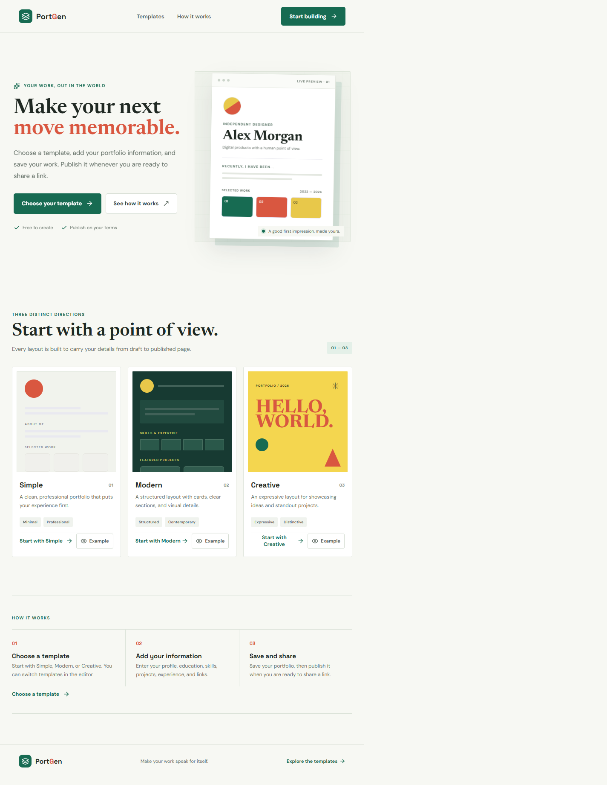
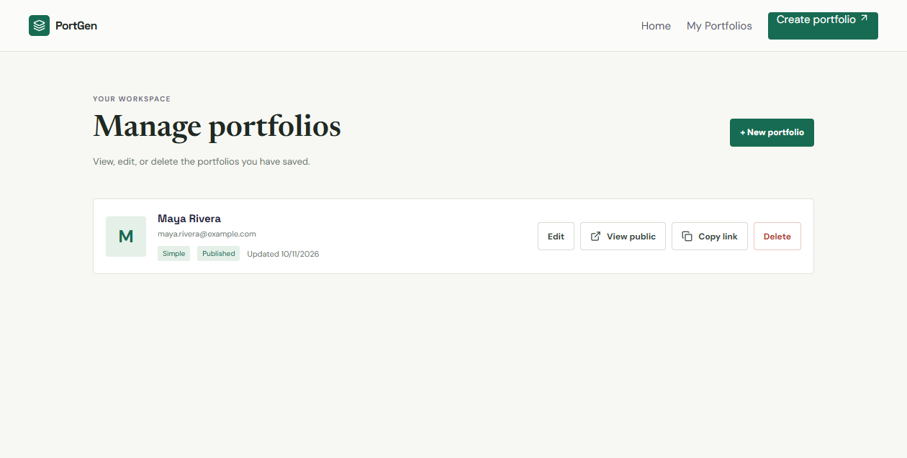
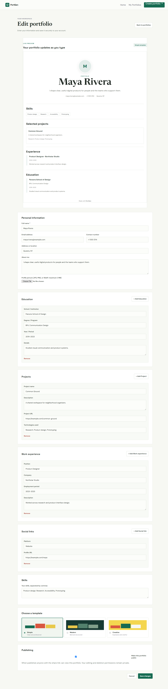
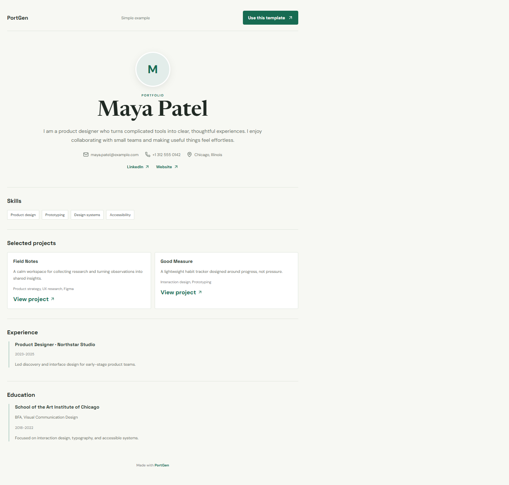
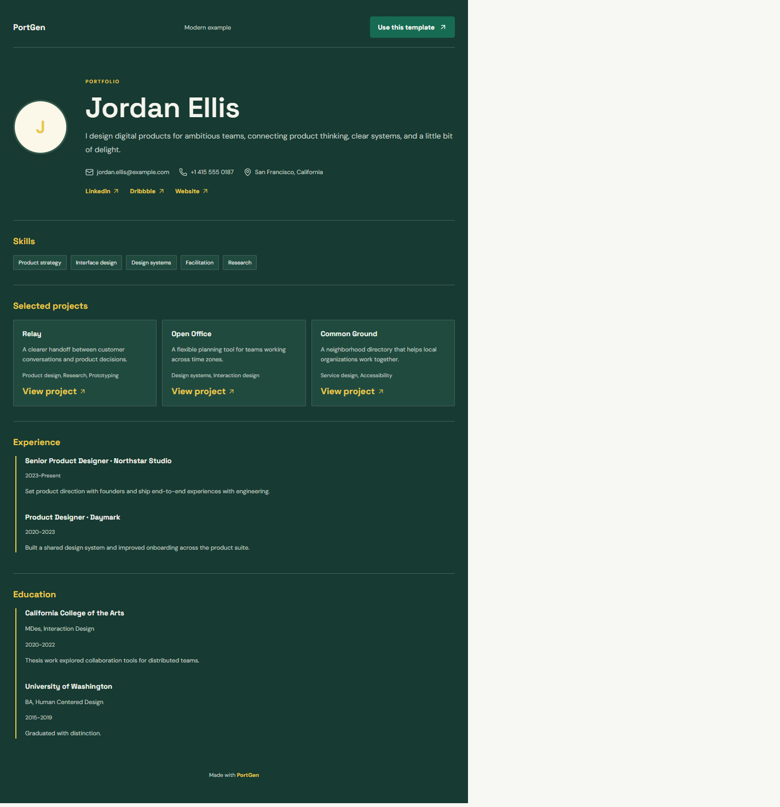
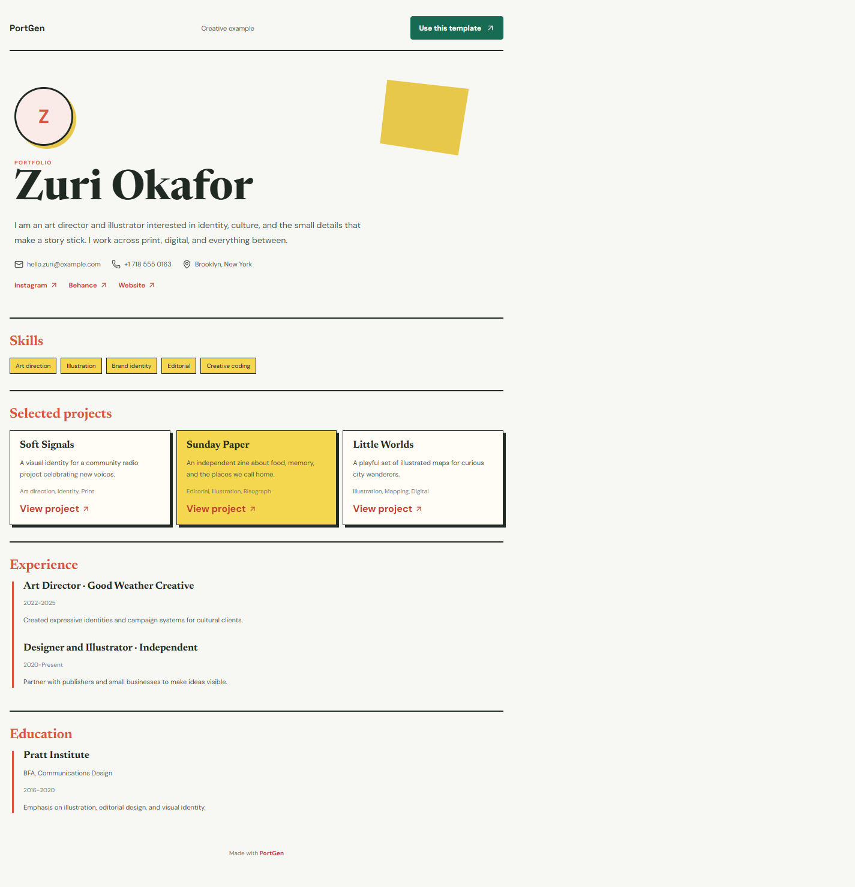

# PortGen: Online Portfolio Template Generator

A responsive React website for creating portfolios, saving them to Supabase, choosing one of three designs, and publishing a shareable portfolio page.

## Submission Status

- **Published website:** Not deployed yet. A hosting account and deployment are still required. Do not submit the local development URL as the public website URL.
- **Target hosting platform:** Vercel. SPA rewrites for direct visits and refreshes on `/manage`, `/editor/:id`, `/examples/:template`, and `/p/:id` are in `vercel.json`.
- **Database:** Supabase Postgres and Supabase Storage.
- **Templates:** Simple, Modern, and Creative.
- **Screenshots:** Home page, manager, editor, and all three public templates are included below.

## Features

- Enter name, profile picture, email, phone, location, biography, education, skills, projects, work experience, and social or website links.
- Add and remove repeatable education, project, experience, and social-link entries.
- Preview content while editing and select from exactly three templates.
- Open a complete sample portfolio for each template at `/examples/simple`, `/examples/modern`, or `/examples/creative` without saving sample data to Supabase.
- Open a complete sample portfolio for each template without saving sample data to Supabase.
- Save and retrieve records from Supabase; edit and delete them from the manager.
- Keep portfolios private by default. Published portfolios are readable from `/p/:id`.
- Upload profile images to the public `profile-images` storage bucket, with writes scoped to the signed-in anonymous user.

## Technologies

- React 19, React Router, Vite, and Lucide React
- Supabase Postgres, anonymous authentication, row-level security, and Storage
- Vercel for the intended static-site deployment

## Supabase Setup

For a **new Supabase project**:

1. Enable anonymous sign-ins in Supabase Authentication settings.
2. Run [`supabase-setup.sql`](supabase-setup.sql) in the SQL Editor. It creates the portfolio table, owner/public RLS policies, update timestamp trigger, and image bucket policies.
3. Copy `.env.example` to `.env.local` and set `VITE_SUPABASE_URL` and `VITE_SUPABASE_PUBLISHABLE_KEY` to that project's values.
4. Never put a Supabase secret or service-role key in a `VITE_` variable or browser code.

For the already configured project, keep its existing table and owner policies. Run [`supabase-publish-migration.sql`](supabase-publish-migration.sql) only if `is_published` and the published-row policy have not already been added. Do not run the fresh-project setup over an existing database without reviewing it first.

### Database Structure

The `public.portfolios` table stores a UUID, owner UUID, contact/profile fields, `is_published`, timestamps, and JSONB arrays for education, skills, projects, work experience, and social links. The `profile-images` Storage bucket is public for image display; upload and delete policies restrict paths to the authenticated user's UUID folder. RLS restricts private records and all writes to their owner while allowing public reads only for published records.

This app uses Supabase anonymous sessions rather than user accounts. A visitor's private manager is tied to that browser's anonymous session; published pages are shared through their public link.

## Run Locally

```sh
npm install
npm run dev
```

For a production build:

```sh
npm run build
npm run preview
```

## Deploy to Vercel

1. Import the source repository into Vercel and keep the Vite defaults (`npm run build`, output directory `dist`).
2. Add `VITE_SUPABASE_URL` and `VITE_SUPABASE_PUBLISHABLE_KEY` under the Vercel project's environment variables for Production and Preview.
3. Deploy, then test creating, publishing, opening, editing, and deleting a portfolio on the deployed domain. Test a direct refresh on `/p/<portfolio-id>` as well.
4. Replace the **Published website** status above with the deployed URL.

Vercel CLI is not installed or authenticated in the current workspace, so no public deployment URL can be claimed from this source tree alone.

## Screenshots

### Home



### Portfolio Manager



### Portfolio Editor



### Simple Template



### Modern Template



### Creative Template



The template screenshots use built-in sample data. The manager and editor screenshots show a temporary QA portfolio that was deleted from Supabase after capture.
